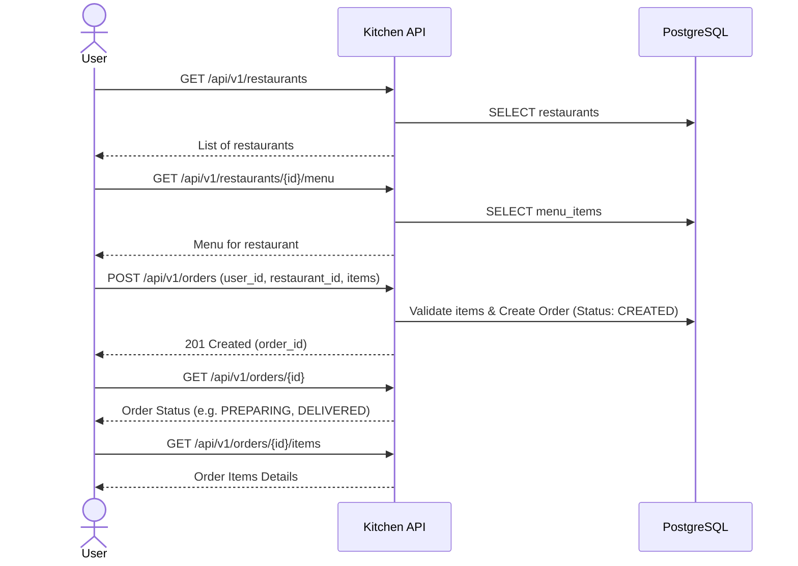
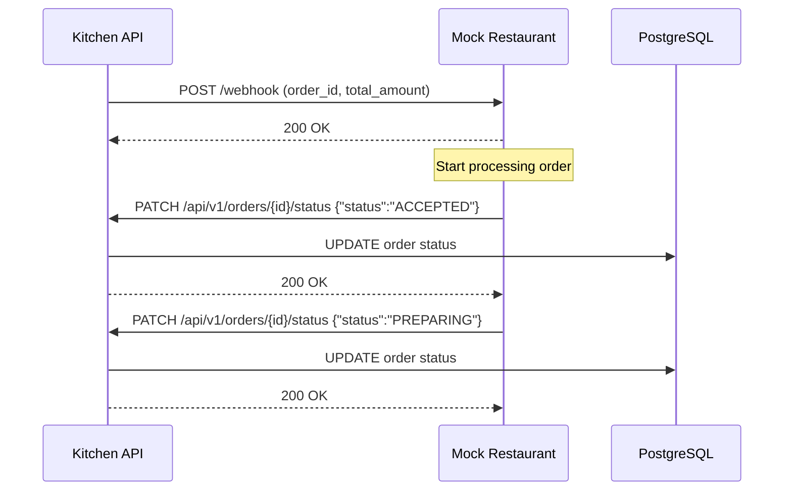
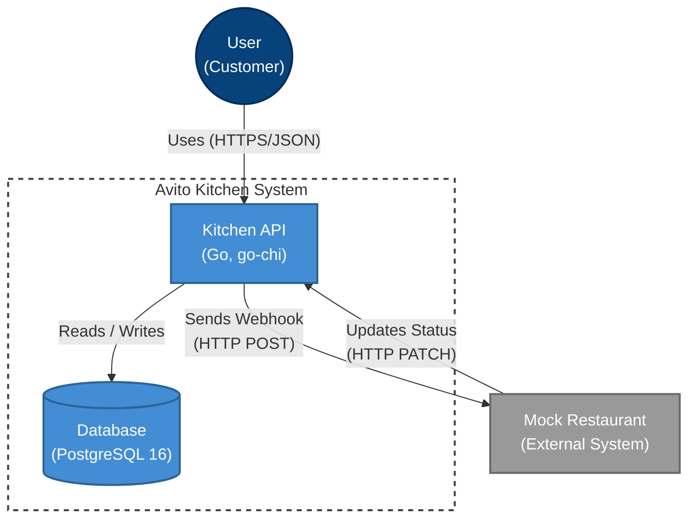

## CJM

### CJM Пользователя


### CJM Ресторана (Через Mock-Сервис)


## Архитектура (C4 Container Diagram)



## Схема Базы Данных
В проекте используются 5 основных таблиц:
- `users`: Пользователи системы.
- `restaurants`: Рестораны с указанием `webhook_url`.
- `menu_items`: Элементы меню ресторана с ценой и доступностью.
- `orders`: Заказы (связаны с пользователем и рестораном, содержат итоговую сумму и статус).
- `order_items`: Связь "один-ко-многим" для конкретных позиций в заказе.

## Запуск
Для запуска всех сервисов выполните команду:
```bash
docker-compose up --build
```
API будет доступно на порту `8080`, Mock-ресторан на порту `8081`. 
База данных Postgres проброшена на порт `15432` (чтобы не конфликтовать с моими локальными серверами).
При первом запуске база автоматически заполняется таблицами и тестовыми данными (ресторанами и меню) через сиды в `/migrations`.

Спецификация API (OpenAPI) находится в `api/openapi.yaml`. 
Конфигурация линтера — `.golangci.yml`. 
